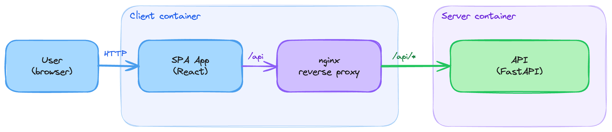

# Planning Hub

A web application that hosts estimation and planning tools for Critical Manufacturing
(CM) projects. Its first tool is **Monte Carlo**, which forecasts how many
sprints are needed to hit a target (Items Resolved or Story Points), using a
Monte Carlo simulation driven by historical sprint data from CM projects.
A second tool, **Release Plan**, plans which Features ship in which release
or sprint on an interactive board built from an imported JSON plan.

Instead of a single-point estimate, the Monte Carlo tool runs thousands of
randomized simulations sampled from a team's own historical sprint
throughput and reports a distribution of outcomes — e.g. "50% of
simulations reach the target within 4 sprints, 95% reach it within 8
sprints" — along with the projected completion dates for each confidence
level.

## Navigation

The app is a dashboard: a header with the CM logo and the hub name, a left
sidebar, and a main content area.

- **Sidebar** — tools are grouped by category. The "Estimations" group
  holds the **Monte Carlo** item (dice icon) and the "Planning" group
  holds the **Release Plan** item (roadmap icon); each is highlighted on
  every page of its tool.
- **Home page (`/`)** — a section per category with a card per tool with a short description
  and its goal; click a card to open the tool. Unknown URLs land here.
- **Monte Carlo (`/monte-carlo`)** — the three-step flow described below:
  `/monte-carlo` (Data Input), `/monte-carlo/confirm` (Data Validation) and
  `/monte-carlo/results` (Simulation Execution). The **How to Use** button
  next to the Monte Carlo step breadcrumb opens the in-app help. Results and
  validation data are kept in memory only, so reloading the Confirm or
  Results page sends you back to `/monte-carlo`.
- **Release Plan (`/release-plan`)** — the entry page lets you choose how
  to create a board (**Import a JSON file**, or **Create from Azure DevOps**,
  shown as "Coming soon") and, when a board already exists, **Continue last
  board**. The board itself is at `/release-plan/board`; opening it with no
  plan sends you back to `/release-plan`. See
  [How the Release Plan tool works](#how-the-release-plan-tool-works).

## How the Monte Carlo tool works

The Monte Carlo tool is a three-step wizard:

### 1. Data Input

The user uploads an Excel file with historical sprint data and fills in the
simulation parameters:

| Parameter                            | Required | Description                                                                                                        |
| ------------------------------------ | -------- | ------------------------------------------------------------------------------------------------------------------ |
| Sprint History Data                  | Yes      | The Excel file with historical sprint data (see format below)                                                      |
| Target Type                          | Yes      | "Items Resolved" or "Story Points" — the metric the simulation forecasts against                                   |
| Target Value                         | Yes      | The number of items/story points to reach                                                                          |
| Number of Simulations                | Yes      | How many Monte Carlo runs to perform (capped at 20000). Default: `1000`                                            |
| Sprint Start Date                    | Yes      | Start date of the first simulated sprint                                                                           |
| Sprint Length                        | Yes      | Length of each sprint, in business days. Default: `10` days.                                                       |
| Team Capacity Factor                 | Yes      | Team capacity relative to the historical data (default `1.0`). E.g., `1.2` means 20% more capacity than historical |
| Skip Historical Sprint Validation    | No       | Bypasses step 2 and jumps straight to execution                                                                    |
| Exclude Latest Sprints from Sampling | No       | Number of most recent sprints to leave out of the random sampling pool (e.g. to exclude an in-progress sprint)     |

### 2. Data Validation (optional)

Unless skipped, the app validates the uploaded file and parameters, then
summarizes the historical data it parsed — one row per sprint, showing
items resolved, story points, last resolved date, a recency rank, and
whether that sprint is included in the simulation's sampling pool. The user
reviews this summary and confirms before running the simulation.

### 3. Simulation Execution

The app runs the requested number of simulations, each one randomly
sampling from the historical sprint data (respecting the sampling-pool
exclusions from step 2) until the target is reached or a 50-sprint window
is exceeded. Each sampled Items Resolved / Story Points value is scaled by
the Team Capacity Factor before being compared against the target, so a
factor above 1.0 reaches the target in fewer sprints than the raw
historical data would suggest, and a factor below 1.0 takes more. Results
are presented per confidence level — P50, P70, P85, and P95 — showing the
number of sprints required and the projected completion date (business
days only), including a calendar view, plus a histogram of the full distribution of outcomes.

## Sprint History Excel file format

The uploaded file must contain one worksheet with these columns:

| Column Name        | Data Type | Mandatory | Notes                                                                                                   |
| ------------------ | --------- | --------- | ------------------------------------------------------------------------------------------------------- |
| **State**          | String    | **Yes**   | Only rows where State is `Resolved`, `Done`, or `Closed` (case-sensitive) count toward a sprint         |
| **Iteration Path** | String    | **Yes**   | The sprint is derived from the last segment after `\`, e.g. `Project\Release 1\Sprint 12` → `Sprint 12` |
| **Resolved Date**  | Date      | **Yes**   | Used to determine each sprint's most recent completion date and recency rank. Format: `MM/dd/yyyy [hh:mm]` (time optional), e.g. `03/27/2025 14:30` |
| **Story Points**   | Numeric   | **Yes**   | Defaults to 0 for rows where it's missing                                                               |
| Work Item Type     | String    | No        | Not used in the simulation                                                                              |
| ID                 | Numeric   | No        | Not used in the simulation                                                                              |
| Activated Date     | Date      | No        | Not used in the simulation                                                                              |
| Created Date       | Date      | No        | Not used in the simulation                                                                              |
| PICategory         | String    | No        | Not used in the simulation                                                                              |

Date columns must use the `MM/dd/yyyy [hh:mm]` format (month first; the
time part is optional), e.g. `03/27/2025` or `03/27/2025 14:30`.

If a mandatory column is missing, or the file can't be parsed as Excel, the
app reports the specific problem instead of failing silently.

## How the Release Plan tool works

The Release Plan tool runs entirely in the browser (no server calls). It
lays out a plan's Epics and Features on a board: Epics are columns, and
each Feature sits in the row (band) of the milestone it is planned for, or
in **Unplanned**.

### Creating a board

- **Import a JSON file** — pick a previously exported plan
  (`"schema": "release-planner-features"`, `"version": 1`) and click
  **Create board**. The file is validated and normalized; problems (not a
  `.json` file, invalid JSON, wrong or missing schema, a User Story plan,
  missing `milestones`/`epics`, entries that aren't objects) are shown
  inline in the dialog, which stays open. If a board already exists you
  are asked **Replace the current board?** first, because the current
  board's changes would be lost.
- **Create from Azure DevOps** — coming soon.

### The board

- **Summary** — one box per milestone (Feature count, size chips, Epics
  completed), one for Unplanned, and one per milestone flag (cumulative
  counts up to that flag).
- **Milestones** — the frozen left column lets you rename a milestone, set
  its date, move it up/down, or delete it (after confirmation; its
  Features become Unplanned). The **+** between milestones inserts a new
  one.
- **Releases / Sprints** — in Releases mode milestones are free-form
  releases. Switching to Sprints (after a confirmation) creates one
  milestone per Iteration Path leaf, dated from the iteration's finish
  date, and resets every Feature to the sprint of its Iteration Path;
  switching back resets everything to a single "MVP" milestone. Either
  switch discards manual planning and flags.
- **Milestone flags** (Sprints mode) — the **+** menu also offers "Add
  milestone flag here"; a flag has a name and a date and appears as a gold
  row on the board.
- **Epics** — ◀/▶ move an Epic left or right.
- **Zoom** — −/+ (30%–150%) and **Fit** (scales the board to the width of
  its scroll area, never above 100%).
- **Table view** — the same plan as a table, with a text search, Epic and
  milestone filters, and a per-Feature milestone select for re-planning.
- **Work-item details** — clicking a Feature card or an Epic title opens a
  modal with its state, size, milestone, Iteration Path and (sanitized)
  description; you can navigate between an Epic and its Features.

Drag-and-drop of Epics and Features is not available yet; use ◀/▶ and the
Table view's milestone select instead.

### Autosave

The current plan is saved in the browser's `localStorage` under the key
`cmEstimationsHub.releasePlan.v1` after every change. Reloading the board
restores it ("Restored your last session"), and the entry page offers
**Continue last board**. Nothing is stored on the server, and if storage is
unavailable the board still works, in memory only. Saving to or loading
from a file inside the board is not available yet.

## Architecture



The app is split into two tiers under `src/`:

- **`src/server`** — FastAPI API (Pandas/NumPy simulation logic), port 8000.
  Endpoints: `POST /api/validate`, `POST /api/simulate`, `GET /api/health`.
- **`src/client`** — React + TypeScript single-page app (Vite, Tailwind),
  served by nginx in production. nginx proxies `/api` to the server, so the
  browser only ever talks to one origin. The dashboard's tools come from a
  small registry (`src/client/src/lib/tools.ts`) that feeds both the
  sidebar and the home page. The Release Plan tool is client-only: its
  logic lives in `src/client/src/lib/releasePlan/` and its state in the
  browser's `localStorage`.

## Running with Docker Compose

```bash
docker compose up --build        # http://localhost:8080
docker compose down
```

The client container listens on 8080 (non-root nginx) and reaches the
server through `API_UPSTREAM` (default `http://server:8000`).

## Building and deploying

```bash
./deploy/build-docker-image.sh -h                         # usage
./deploy/build-docker-image.sh -t 1.2.3 --no-push         # build client + server images
./deploy/build-docker-image.sh -t 1.2.3 -u <user> -p <pat> # build and push both
```

Releases are made by the manual **Deploy** GitHub workflow: it computes the
version with GitVersion, runs the server and client tests, builds and pushes
`estimationshub/estimationshub-client` and `estimationshub/estimationshub-server`
with that tag, and tags the commit. The Helm chart in `helm/chart` deploys
both (set `tag` in `values.yaml`); the ingress sends `/api` to the server and
everything else to the client.

## Running locally (development)

Requires Python 3.12 and Node 22 (both are set up by the devcontainer,
which also installs the server and client dependencies).

```bash
# Server — http://localhost:8000
cd src/server
pip install -r requirements.txt
uvicorn app.main:app --reload --port 8000

# Client — http://localhost:5173 (Vite proxies /api to localhost:8000)
cd src/client
npm ci
npm run dev
```

## Tests

```bash
cd src/server && pytest              # server (or `pytest src/server` from the repo root)
cd src/client && npm test -- --run   # client (Vitest)
cd src/client && npm run build       # type-check + production build
```

See `CLAUDE.md` for architecture notes and `specs/` for the full functional
specification.
